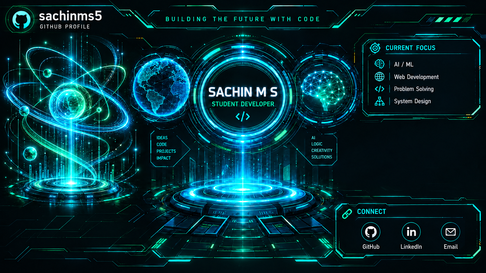

<div align="center">



<a href="https://readme-typing-svg.demolab.com/demo/"></a>

### `STUDENT DEVELOPER • AI/ML • WEB DEVELOPMENT`

*Learning by building. Turning ideas into working projects.*

[](https://github.com/sachinms5)

</div>

---

## `> WHOAMI`

Hey! I'm **Sachin MS**, a student developer exploring AI/ML and web development.

I'm learning by building practical projects, experimenting with technologies, and improving my programming skills step by step.

- 🤖 Exploring AI-powered applications and intelligent platforms.
- 🌐 Building web interfaces and interactive dashboards.
- 🛠️ Learning programming, backend development, and API integration.
- 🚀 Interested in hackathons, innovation, and real-world problem-solving.

---

## `> FEATURED PROJECTS`

### `01` / ANTARA — AI Competency Intelligence Platform

An AI-focused platform exploring competency intelligence and intelligent systems.

- Developing a web-based platform.
- Exploring backend and AI-service architecture.
- Working with modern web technologies and AI integration.

[](https://antaraibm.vercel.app/)

**Live website:** https://antaraibm.vercel.app/

---

### `02` / NESHAKTI — Logistics & Accessibility Intelligence

A prototype concept focused on logistics, route planning, weather awareness, and accessibility across Northeast India.

- Interactive logistics dashboard and maps.
- Route visualization and planning interfaces.
- Weather information and alerts.
- Analytics and simulation-based demonstrations.

[](https://6aa12717589f5e04a48a3714--zippy-choux-531db4.netlify.app/)

---

## `> TECH ARSENAL`

**Programming**


**Web development**


**Tools**


---

## `> GITHUB ANALYTICS`

<div align="center">


<a href="https://github.com/sachinms5"></a>

</div>

---

## `> CURRENT_MISSION`

```text
[ ACTIVE ] Strengthen programming fundamentals
[ ACTIVE ] Build practical web applications
[ EXPLORE ] AI/ML and intelligent systems
[ NEXT ] Improve project quality and documentation
[ ALWAYS ] Learn. Build. Improve.
```

---

## `> CONNECT`

<div align="center">

[](https://github.com/sachinms5)

**INNOVATE • BUILD • REPEAT**


</div>
